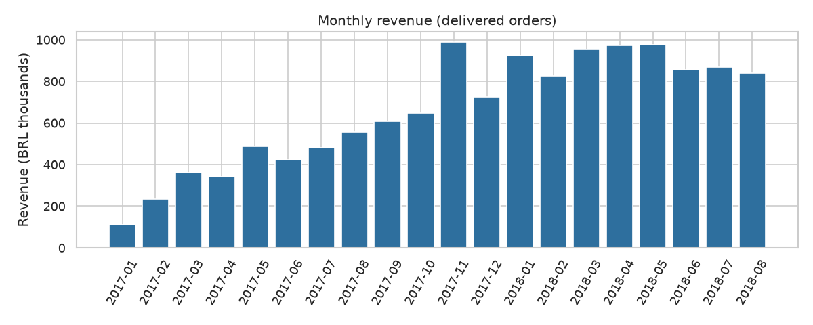
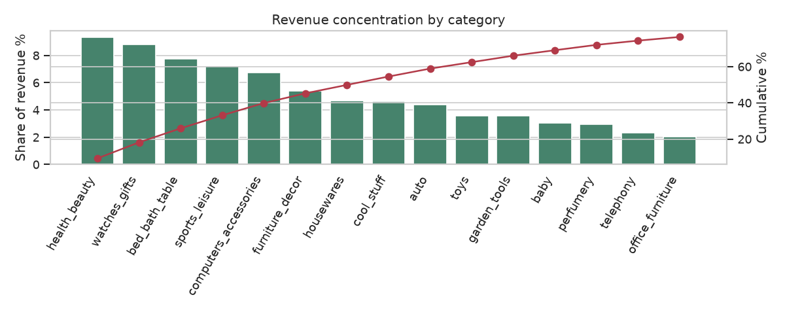
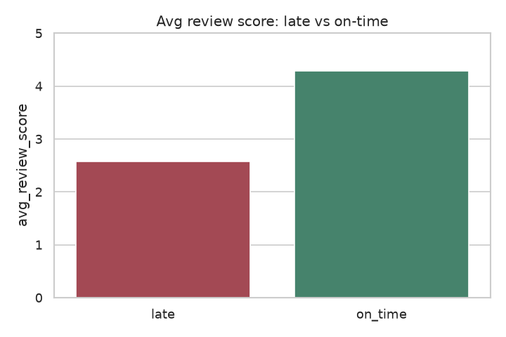
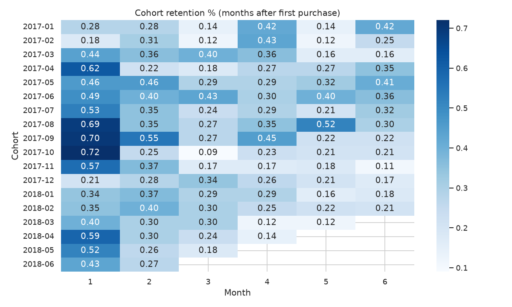

# E-Commerce Sales & Customer Analytics (SQL + Python)

End-to-end business analysis of **96,478 delivered orders** from [Olist](https://www.kaggle.com/datasets/olistbr/brazilian-ecommerce), a Brazilian e-commerce marketplace (Jan 2017 – Aug 2018). All analysis is written in **SQL** (CTEs, joins, window functions) and run on DuckDB. Python builds the charts and an interactive KPI dashboard.

**[Live dashboard](https://mukulkatewa.github.io/ecommerce-sales-analytics/)**

## Key findings

| # | Insight | Number |
|---|---------|--------|
| 1 | **Late deliveries hurt reviews badly.** Late orders average **2.57★** vs **4.29★** on-time, and are **5.9× more likely** to get a 1–2★ review (54% vs 9%). | 8.0% of orders arrive late |
| 2 | **Revenue is concentrated.** The top **10 of 72 categories** generate **62%** of revenue (health & beauty, watches & gifts, bed/bath/table lead). | Pareto |
| 3 | **Retention is the biggest growth gap.** Only **3.0%** of customers ever place a second order; median month-1 cohort retention is **0.47%**. | 93,358 customers |
| 4 | **Black Friday spike.** Nov 2017 revenue grew **+52% MoM**, the largest jump in the period. | R$ 988k in Nov-17 |
| 5 | **Geographic concentration.** São Paulo (SP) alone is **38%** of revenue; RJ and BA have more than 2× SP's late-delivery rate (13–14% vs 5.9%). | 27 states |
| 6 | **Payments.** Credit card is used on **75%** of orders, averaging 3.5 installments. | |

### Recommendations
1. **Fix logistics in high-late states (RJ, BA, CE)**: carrier SLAs or regional fulfilment. This is the clearest lever on review scores.
2. **Launch a retention program**: post-purchase email flows and second-order coupons. Even moving repeat rate from 3% to 5% is a large revenue gain on a 93k customer base.
3. **Protect the top categories** with stock availability and promotions, especially ahead of Black Friday.

## Charts





## SQL queries
| File | Technique |
|------|-----------|
| [`01_monthly_revenue_mom.sql`](sql/01_monthly_revenue_mom.sql) | CTE, `LAG()` window for month-over-month growth, AOV |
| [`02_category_revenue_share.sql`](sql/02_category_revenue_share.sql) | `RANK()`, running `SUM() OVER` for cumulative (Pareto) share |
| [`03_cohort_retention.sql`](sql/03_cohort_retention.sql) | Multi-step CTEs for monthly acquisition cohorts |
| [`04_repeat_customer_rate.sql`](sql/04_repeat_customer_rate.sql) | Aggregation + conditional `CASE` |
| [`05_delivery_vs_reviews.sql`](sql/05_delivery_vs_reviews.sql) | Join of orders and reviews, late vs on-time comparison |
| [`06_state_performance.sql`](sql/06_state_performance.sql) | Ranked state KPIs with conditional distinct counts |
| [`07_payment_mix.sql`](sql/07_payment_mix.sql) | Share-of-total via `SUM() OVER ()` |

Query results are saved in [`outputs/`](outputs/).

## Run it
```bash
pip install -r requirements.txt
./download_data.sh          # fetches the public Olist CSVs
python run_analysis.py      # runs every query in sql/ -> outputs/*.csv
python build_dashboard.py   # charts/ + docs/index.html dashboard
```

## Notes
- Revenue = item price on **delivered** orders (freight excluded).
- Customers are de-duplicated with `customer_unique_id` (Olist issues a new `customer_id` per order).
